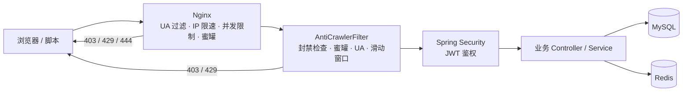

# 反爬虫 / 接口防刷设计与检验

> 适用范围：`student-digital-human` 当前 Java 后端（Spring Boot 4）、Nginx 统一入口。
> 目标不是“绝对防住所有爬虫”，而是用较低成本拦住绝大多数脚本采集、撞库、短信刷量和
> 漏洞扫描，并让正常浏览器用户无感。

---

## 一、已完成的反爬能力

| 层级 | 能力 | 实现位置 | 触发结果 |
|---|---|---|---|
| Nginx 边缘层 | 可疑 User-Agent 拦截 | `nginx/nginx.conf` 的 `map $http_user_agent $bad_bot` | HTTP 403 |
| Nginx 边缘层 | 单 IP 请求速率限制（认证 / AI / 扫码 / 通用 API 分档） | `limit_req_zone` + 各 `location` 的 `limit_req` | HTTP 429 |
| Nginx 边缘层 | 单 IP 并发连接限制 | `limit_conn_zone` + `limit_conn` | HTTP 429 |
| Nginx 边缘层 | 蜜罐路径直接断开 | `/.env`、`/.git/`、`/.svn/`、`/trap/`、`/phpmyadmin/`、`/wp-login.php` | 连接被关闭（444） |
| Nginx 边缘层 | `robots.txt` 全站禁爬、接口禁止收录 | `location = /robots.txt`、`X-Robots-Tag` | 200 + `Disallow: /` |
| 后端入口 | IP 封禁、蜜罐、可疑 UA、滑动窗口限流 | `AntiCrawlerFilter` | 403 / 429 + 统一 JSON |
| 后端入口 | 违规累计后自动临时封禁 | `AntiCrawlerGuard.recordViolation` | 后续请求 403 |
| 登录业务 | 账号 / IP 维度登录失败锁定 | `AntiCrawlerGuard` + `AuthServiceImpl` | 业务码 `1006` |
| 已有能力 | 短信验证码 60 秒频控 | `AuthController.sendSmsCode` | 业务码 `1006` |

防护链路：



---

## 二、默认策略

所有默认值都在 `AntiCrawlerProperties` 中，未配置也能生效。需要调整时，在**本地**
`application-dev.yaml`（已加入 `.gitignore`）里覆盖；公共模板见
`application-dev.example.yaml` 末尾的 `anti-crawler` 注释段。

| 配置项 | 默认值 | 含义 |
|---|---|---|
| `anti-crawler.enabled` | `true` | 后端反爬总开关 |
| `anti-crawler.add-security-headers` | `true` | 是否添加 `X-Robots-Tag`、`no-store` 等响应头 |
| `rules[name=auth].limit` | `10` 次 / 60 秒 | 登录、注册、短信、刷新令牌、旧版登录接口 |
| `rules[name=ai].limit` | `30` 次 / 60 秒 | `/api/v1/ai/**` |
| `rules[name=qr].limit` | `120` 次 / 60 秒 | `/qr/**` 扫码轮询 |
| `rules[name=api].limit` | `300` 次 / 60 秒 | 其余 `/api/**`、`/ws/**` |
| `ban.violation-threshold` | `10` | 5 分钟内累计 10 次违规后封禁 |
| `ban.violation-window-seconds` | `300` | 违规统计窗口 |
| `ban.duration-seconds` | `600` | 封禁 10 分钟 |
| `user-agent.block-empty` | `true` | 空 UA 视为脚本 |
| `user-agent.blocked-keywords` | 见配置类 | `python-requests`、`scrapy`、`curl/`、`okhttp` 等 |
| `login.max-failures` | `5` | 同一账号 15 分钟内失败 5 次后锁定 |
| `login.max-ip-failures` | `30` | 同一 IP 失败 30 次后锁定（避免 NAT 误伤） |
| `login.window-seconds` / `lock-seconds` | `900` / `900` | 统计窗口 / 锁定时长均为 15 分钟 |

Nginx 侧默认值：

| location | 速率 | 突发 | 单 IP 并发 |
|---|---|---|---|
| `/api/v1/ai/` | 2 r/s | 20 | 20 |
| `/api/v1/auth/` | 1 r/s | 10 | 10 |
| `/api/` | 20 r/s | 60 | 30 |
| `/qr/` | 5 r/s | 40 | 20 |
| `/ws/` | 20 r/s | 10 | 5 |

---

## 三、关键代码位置

| 文件 | 作用 |
|---|---|
| `backend/.../config/AntiCrawlerProperties.java` | 反爬配置与内置默认值 |
| `backend/.../config/AntiCrawlerConfig.java` | 注册 `@ConfigurationProperties` |
| `backend/.../security/AntiCrawlerFilter.java` | 入口过滤器：封禁 → 蜜罐 → UA → 限流 |
| `backend/.../security/AntiCrawlerGuard.java` | Redis 滑动窗口、违规计数、封禁、登录锁定 |
| `backend/.../util/ClientIpUtil.java` | 安全解析真实 IP（防伪造 `X-Real-IP`） |
| `backend/.../service/impl/AuthServiceImpl.java` | 登录成功 / 失败时维护风控计数 |
| `backend/.../common/RedisKeys.java` | 风控 Redis key 规范 |
| `backend/.../common/ErrorCode.java` | 新增 `1013 = ACCESS_BLOCKED` |
| `nginx/nginx.conf` | 边缘层 UA、限速、并发、蜜罐、robots |
| `scripts/anti-crawler-check.ps1` | 一键验收脚本 |
| `backend/src/test/.../AntiCrawlerFilterTest.java` | 过滤器单元测试 |
| `backend/src/test/.../ClientIpUtilTest.java` | IP 解析单元测试 |

Redis key：

```text
ai_tutor:anti:rate:{rule}:{ip}          # 滑动窗口 ZSET
ai_tutor:anti:ban:{ip}                  # 封禁标记，TTL = 封禁时长
ai_tutor:anti:violation:{ip}            # 违规计数，TTL = 统计窗口
ai_tutor:auth:login:fail:account:{账号}
ai_tutor:auth:login:fail:ip:{ip}
ai_tutor:auth:login:lock:account:{账号}
ai_tutor:auth:login:lock:ip:{ip}
```

> 所有 key 都带 TTL；Redis 不可用时反爬组件**降级放行**并打 WARN 日志，
> 避免风控本身把业务拖垮。若生产环境要求“宁可不服务也不放行”，可把
> `AntiCrawlerGuard` 中的 catch 分支改成拒绝请求。

---

## 四、如何检验（重点）

### 4.1 第一步：编译 + 单元测试

```powershell
# 按本机 JDK 修改；IDEA 用户可直接在 Maven 面板执行 test
$env:JAVA_HOME = "C:\Users\yuanl\.jdks\jbr-21.0.11"
cd D:\DeepSeek\student-digital-human\backend

mvn test -Dtest=AntiCrawlerFilterTest,ClientIpUtilTest
```

预期：

```text
Tests run: 12, Failures: 0, Errors: 0, Skipped: 0
BUILD SUCCESS
```

覆盖点：

- 可疑 UA / 空 UA → 403；
- 超过限流 → 429、`Retry-After`、业务码 `1006`；
- 正常请求 → 放行且带 `X-Robots-Tag`、`X-RateLimit-*`；
- 白名单（健康检查）→ 完全跳过风控；
- 蜜罐 → 403 且调用封禁；
- 已封禁 IP → 直接 403，不再消耗限流脚本；
- 公网直连伪造 `X-Real-IP` → 不采信，仍使用 `remoteAddr`。

### 4.2 第二步：启动依赖和后端

```powershell
cd D:\DeepSeek\student-digital-human
docker compose up -d mysql redis nginx
cd backend
mvn spring-boot:run
```

确认：

```powershell
curl.exe -i http://localhost:8080/api/v1/health
```

应返回 `200` 和 `{"code":200,"msg":"success",...}`。

> 如果 8080 被占用，改 `server.port`，并在运行脚本时传 `-BaseUrl`。
> Nginx 容器映射到宿主 `8090`（见 `docker-compose.yml`）。

### 4.3 第三步：一键验收脚本

```powershell
cd D:\DeepSeek\student-digital-human
pwsh -ExecutionPolicy Bypass -File scripts/anti-crawler-check.ps1
```

脚本默认直连 `http://localhost:8080`，并自动验证：

1. 健康检查可达；
2. 响应头包含 `X-Robots-Tag: noindex...`、`X-RateLimit-Limit: 10`；
3. `python-requests` UA 被 403 拦截；
4. 同一账号连续 6 次错误密码触发 `1006` 锁定；
5. 同一 IP 15 次登录请求中出现 429 + `Retry-After`；
6. 访问 `/trap/secret` 后，同 IP 后续请求被 403 封禁；
7. Nginx 正常转发、拦截可疑 UA、并发 120 请求触发 429；
8. 结束后清理脚本写入的 Redis key。

预期输出（节选）：

```text
== 反爬虫验收：http://localhost:8080 ==
[PASS] 健康检查可达
[PASS] 接口返回反抓取响应头
[PASS] 拦截 python-requests UA
[PASS] 连续登录失败触发锁定
[PASS] 接口限流返回 429
[PASS] 命中蜜罐后 IP 被临时封禁
[PASS] Nginx 正常转发
[PASS] Nginx 拦截可疑 UA
[PASS] Nginx 限流返回 429

结果：通过 9  失败 0  跳过 0
```

> 当前 Java 后端还没有加入 `docker-compose`，Nginx 里的 `backend:8080` 无法解析时，
> `Nginx 正常转发` 会显示 `SKIP status=502`，这是**部署状态**导致的，不是反爬失败；
> Nginx 的 UA 拦截、蜜罐、限流仍会正常 PASS。后端容器化后，可加
> `-RequireNginxBackend` 让 502 严格判为失败。

可选参数：

```powershell
# Nginx 未启动时跳过边缘层用例
... -SkipNginx

# 后端已容器化时，要求 Nginx 转发必须 200
... -RequireNginxBackend

# 保留 Redis 现场，便于观察 TTL / ZSET
... -KeepState

# 指定地址与 Redis 容器名
... -BaseUrl http://localhost:8080 -NginxUrl http://localhost:8090 -RedisContainer aitutor-redis
```

### 4.4 第四步：手工逐项验证

以下命令都在 PowerShell 中执行，使用 `curl.exe` 避免 `curl` 别名干扰。
**因为默认会拦截 `curl/` UA，所以正常请求必须带浏览器 UA。**

#### （1）正常请求 + 安全响应头

```powershell
curl.exe -i -A "Mozilla/5.0" -H "Content-Type: application/json" `
  -d '{"refreshToken":"bad"}' http://localhost:8080/api/v1/auth/refresh
```

预期：`HTTP/1.1 200`（业务码 `1002`，refreshToken 无效），并包含：

```text
X-Robots-Tag: noindex, nofollow, noarchive
X-Content-Type-Options: nosniff
Cache-Control: no-store
X-RateLimit-Limit: 10
X-RateLimit-Remaining: 9
```

> 健康检查 `/api/v1/health` 在 whitelist 中，不会返回 `X-RateLimit-*`，这是正常的。
> 普通业务接口（如 `/api/v1/auth/me`）命中 `api` 规则，`X-RateLimit-Limit` 为 `300`。

#### （2）可疑 User-Agent

```powershell
curl.exe -i -A "python-requests/2.31.0" http://localhost:8080/api/v1/auth/me
```

预期：

```text
HTTP/1.1 403
{"code":1013,"msg":"访问被拒绝","data":null}
```

#### （3）认证接口限流

同一 IP 连续请求登录接口 15 次：

```powershell
1..15 | ForEach-Object {
  curl.exe -s -o NUL -w "%{http_code}`n" -A "Mozilla/5.0" `
    -H "Content-Type: application/json" `
    -d '{"username":"probe'$_'","password":"x","loginType":1}' `
    http://localhost:8080/api/v1/auth/login
}
```

预期：前 10 次为 `200`（业务上返回“账号或密码错误”），第 11 次起出现 `429`。
`429` 响应包含 `Retry-After`，响应体业务码 `1006`。

> 如果想立刻复测，等待 60 秒，或删除 Redis 中的
> `ai_tutor:anti:rate:auth:{你的IP}`。

#### （4）登录失败锁定

```powershell
1..6 | ForEach-Object {
  curl.exe -s -A "Mozilla/5.0" -H "Content-Type: application/json" `
    -d '{"username":"nobody_probe","password":"x","loginType":1}' `
    http://localhost:8080/api/v1/auth/login
}
```

预期：前 5 次返回“账号或密码错误”，第 6 次返回：

```json
{"code":1006,"msg":"登录尝试过于频繁，请 15 分钟 后再试","data":null}
```

#### （5）蜜罐 + 自动封禁

```powershell
curl.exe -i -A "Mozilla/5.0" http://localhost:8080/trap/secret
curl.exe -i -A "Mozilla/5.0" http://localhost:8080/api/v1/auth/me
```

预期：

- 第一条：`403`，`{"code":1013,...}`，并立即封禁该 IP 10 分钟；
- 第二条：即使访问正常接口，也返回 `403`、`Retry-After`，提示“访问异常，已被临时限制”。

#### （6）Nginx 语法与边缘层

```powershell
cd D:\DeepSeek\student-digital-human
docker compose exec nginx nginx -t
```

预期：

```text
nginx: the configuration file /etc/nginx/conf.d/default.conf syntax is ok
nginx: configuration file /etc/nginx/conf.d/default.conf test is successful
```

通过 Nginx 访问：

```powershell
curl.exe -i -A "Mozilla/5.0" http://localhost:8090/api/v1/health
curl.exe -i -A "python-requests/2.31.0" http://localhost:8090/api/v1/health
curl.exe -i -A "Mozilla/5.0" http://localhost:8090/robots.txt
```

预期：`200` / `403` / `200`，且 `robots.txt` 内容为：

```text
User-agent: *
Disallow: /
```

Nginx 的 429 是 Nginx 自己返回的 HTML 页面，不是后端 JSON；这是边缘层和应用层
采用不同实现的正常现象。

#### （7）观察 Redis 状态

```powershell
docker exec aitutor-redis redis-cli --scan --pattern "ai_tutor:anti:*"
docker exec aitutor-redis redis-cli TTL "ai_tutor:anti:ban:203.0.113.15"
docker exec aitutor-redis redis-cli ZCARD "ai_tutor:anti:rate:auth:203.0.113.14"
```

预期：能看到 rate / ban / violation key，`TTL` 为正数（封禁剩余秒数），
`ZCARD` 为窗口内请求数。

#### （8）清理测试数据

```powershell
docker exec aitutor-redis redis-cli --scan --pattern "ai_tutor:anti:*" |
  ForEach-Object { docker exec aitutor-redis redis-cli DEL $_ }

docker exec aitutor-redis redis-cli --scan --pattern "ai_tutor:auth:login:*" |
  ForEach-Object { docker exec aitutor-redis redis-cli DEL $_ }
```

> 不要用 `FLUSHDB`，会清掉登录 token 黑名单、RBAC 权限缓存等其他业务数据。

### 4.5 验收通过标准

- [ ] `mvn test` 中新增反爬用例全部通过，无失败；
- [ ] 浏览器正常打开前端、登录、轮询扫码、聊天不受影响；
- [ ] 正常接口响应带 `X-Robots-Tag`、`Cache-Control: no-store`；
- [ ] `python-requests` / `scrapy` / 空 UA 请求返回 403；
- [ ] 认证接口 1 分钟内第 11 次请求返回 429，带 `Retry-After`；
- [ ] 同一账号 6 次错误密码后返回 `1006`，等待 15 分钟或清 key 后恢复；
- [ ] 访问 `/trap/secret` 后同 IP 正常接口被 403 封禁；
- [ ] `docker compose exec nginx nginx -t` 语法通过；
- [ ] `curl` 通过 8090 访问时，`python-requests` 被 Nginx 403，突发请求出现 Nginx 429；
- [ ] Redis 风控 key 均有 TTL，不会无限增长；
- [ ] 全程无 500；Nginx 转发 502 仅在 Java 后端未容器化时出现，容器化后应消失；

---

## 五、参数怎么调

| 场景 | 建议 |
|---|---|
| 校园网 / 公司 NAT 后很多用户共用出口 IP | 调大 `api.limit`（如 600/60s）、`login.max-ip-failures`（如 60）；不要直接关闭 |
| 演示 / 答辩环境 | 保持默认即可；若演示脚本用 `curl`，加 `-A "Mozilla/5.0"` 或临时 `anti-crawler.enabled: false` |
| 公网生产 | 保持 Nginx + 后端双层；把 `ban.duration-seconds` 提高到 1800~3600 |
| AI 接口成本敏感 | 降低 `ai.limit`，并在 AI 服务侧再加 token / 日额度限制 |
| 误封了某个 IP | 删除 `ai_tutor:anti:ban:{ip}` 即可立即解封 |
| 临时排查 | 本地 yaml 设 `anti-crawler.enabled: false`；Nginx 的 UA 拦截仍需用正常 UA 访问 |

修改配置示例（写入本地 `application-dev.yaml`，不要提交）：

```yaml
anti-crawler:
  enabled: true
  rules:
    - name: auth
      paths:
        - /api/v1/auth/login
        - /api/v1/auth/register
        - /api/v1/auth/sms/code
        - /api/v1/auth/sms/login
        - /api/v1/auth/refresh
        - /api/v1/user/login
      limit: 10
      window-seconds: 60
  ban:
    violation-threshold: 10
    violation-window-seconds: 300
    duration-seconds: 1800
```

---

## 六、限制与后续可做

当前方案能挡住“低成本脚本 + 常见扫描器 + 单 IP 高频”，但**不能**替代专业 WAF：

- 住宅代理 / 代理池会分散 IP，单 IP 限流效果下降；
- 使用真实浏览器 UA 的无头浏览器（Playwright + stealth）可绕过 UA 判断；
- 分布式低速采集可能长期低于阈值；
- 未接入图形 / 行为验证码，登录锁定只能延缓撞库；
- 如果 Nginx 前面还有 CDN / 云负载均衡，`$remote_addr` 会变成 CDN 回源 IP，
  需要启用 Nginx `real_ip` 模块还原真实客户端 IP，否则所有用户会共享同一个限流桶；
- 后端 8080 不应直接暴露公网 / 校园网。`ClientIpUtil` 只在内网来源时信任
  `X-Real-IP`，但若攻击者能从内网直连后端，仍可能伪造该头绕过 IP 限流。

后续可按优先级补充：

1. 登录 / 注册接入验证码（滑块、图形或第三方）；
2. 设备指纹 + 账号维度行为基线（同一账号短时间大量不同资源）；
3. 接口返回字段最小化、列表分页上限、资源 ID 不可枚举；
4. Nginx `limit_req` 日志接入告警（如 429 突增），或 Fail2ban 自动封禁；
5. 对高价值内容接口增加签名 / 短时 token（前端每次请求带一次性票据）。

---

## 七、常见问题

**Q1：为什么我用 `curl` 访问一直是 403？**
默认 `user-agent.blocked-keywords` 和 Nginx `$bad_bot` 都包含 `curl/`。这是预期行为，
请加 `-A "Mozilla/5.0"`，或把 `curl/` 从配置中移除（不推荐生产这样做）。

**Q2：为什么登录接口返回的是 HTTP 200，但 `code=1006`？**
登录失败锁定走的是项目统一的 `BusinessException` → `Result` 包装，HTTP 仍为 200；
过滤器层面的限流才是 HTTP 429。两者都能在前端提示，验收时看 `code` 字段。

**Q3：为什么访问 `/api/v1/health` 没有限流响应头？**
健康检查在白名单中，用于容器 / 监控探活，不参与风控。需要限流可把它从
`whitelist-paths` 移除，但要注意监控频率。

**Q4：测试后本机被 403 了怎么办？**
删除对应封禁 key：

```powershell
docker exec aitutor-redis redis-cli DEL "ai_tutor:anti:ban:127.0.0.1"
```

**Q5：Nginx 启动失败提示 `unknown directive "limit_req_zone"`？**
该指令必须位于 `http` 上下文。本文件通过 `conf.d/*.conf` 被 include 到 `http` 内，
是合法的；若你把它改成独立 `server` 文件并放到错误位置，就会报这个错。

**Q6：Redis 挂了会不会整个系统不能用？**
不会。`AntiCrawlerGuard` 对 Redis 异常做了降级放行并打 WARN；此时反爬能力下降，
但登录、查询等业务仍可用。生产环境建议给 Redis 配持久化和监控。