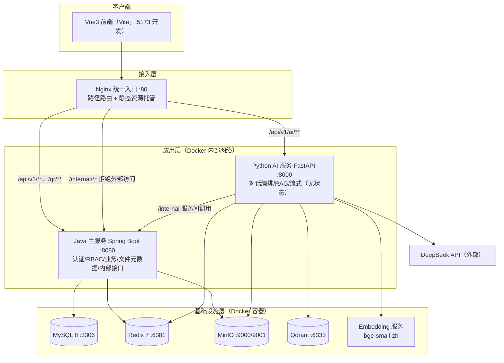
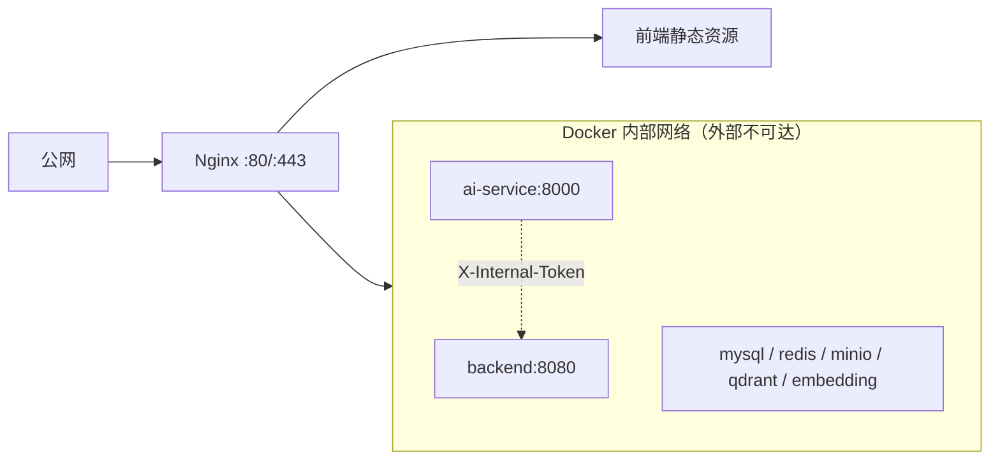
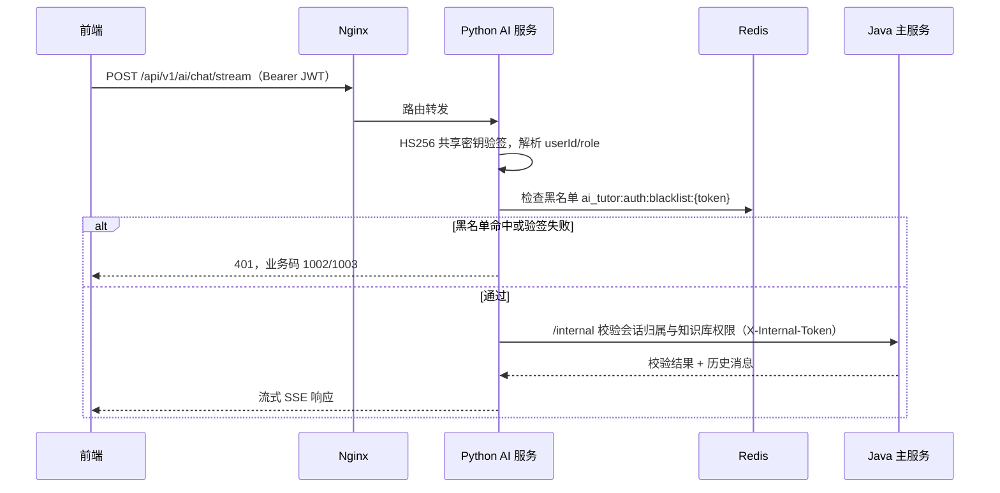
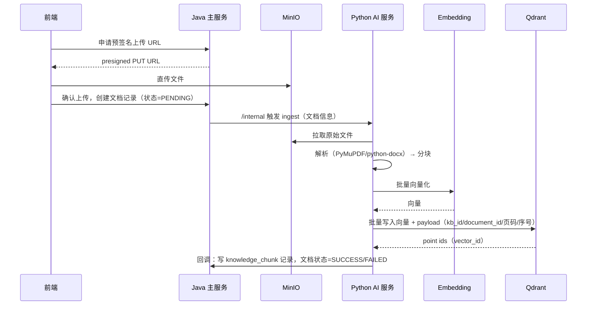
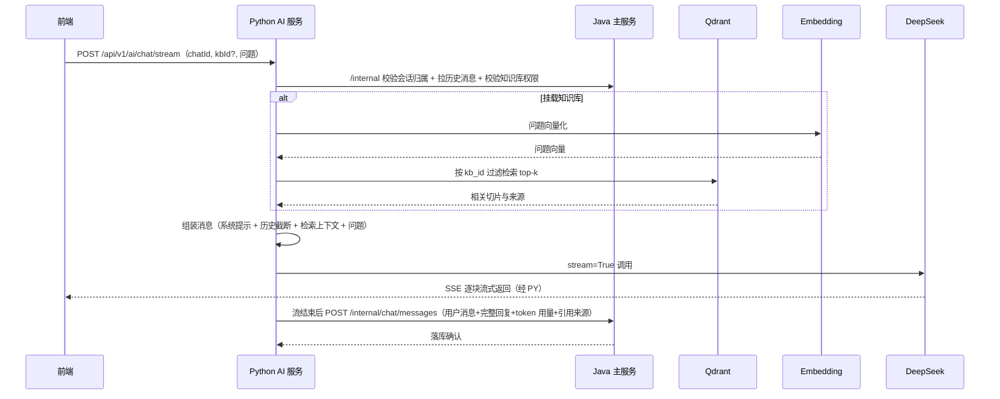

# 大学生辅助学习 AI 数字人系统 — 架构设计文档

| 项 | 内容 |
| --- | --- |
| 文档版本 | v1.0 |
| 创建日期 | 2026-11-12 |
| 适用范围 | 毕业设计（需上线，非商业用途），4 人开发小组 |
| 读者 | 后端、前端、AI 服务开发人员；答辩评审 |
| 关联文档 | `docs/api-docs/大学生辅助学习AI数字人系统API接口文档 (1).md`、`docs/sql/ai_tutor.sql`、`docs/sql/rbac.sql` |

---

## 1. 背景与目标

### 1.1 项目背景

系统面向高校学习场景，提供 AI 数字人答疑、课程知识库、作业辅导、备考等能力，使用者分为学生、教师、教务三类角色。当前已完成 Spring Boot 后端的认证与 RBAC 基础能力（账号密码/短信/扫码登录、JWT、角色权限、登录日志），业务功能尚未大规模展开。

后续建设涉及三类能力：

1. 三类角色共用的业务系统；
2. 基于 MinIO 的文件存储；
3. 基于第三方大模型（DeepSeek）的 AI 对话与 RAG 知识库能力，计划使用 Python 开发。

### 1.2 设计目标

- 结构清晰、边界明确，4 人小组可并行开发；
- 一套系统覆盖三类角色，避免重复建设；
- 认证统一、权限可管，服务拆分后身份不分裂；
- 全部组件容器化，一台云服务器可部署上线；
- 控制第三方 API 成本，防止异常调用产生高额账单；
- 为后续演进预留边界，但不提前过度设计。

### 1.3 关键决策记录

| 编号 | 决策项 | 结论 |
| --- | --- | --- |
| D1 | 总体架构 | 模块化单体（Java 主服务）+ 异构 AI 服务（Python），不做全量微服务 |
| D2 | 三角色系统 | 合为一个后端服务，通过 RBAC 区分；前端按角色渲染，不按角色拆服务 |
| D3 | AI 服务 | 独立 Python FastAPI 服务，技术栈异构与资源隔离是拆分理由 |
| D4 | 文件存储 | MinIO 容器作为基础设施，不单独写文件微服务；预签名 URL 直传 |
| D5 | 大模型 | DeepSeek，OpenAI 兼容接口，默认 `deepseek-v4-flash` |
| D6 | 向量库 | Qdrant 容器，向量与 MySQL 业务库分离 |
| D7 | Embedding | 本地容器部署 bge-small-zh（自托管，零持续调用费） |
| D8 | AI 入口 | Nginx 路径路由，前端直连 Python 服务，Python 本地验 JWT |
| D9 | 消息落库 | Python 生成结束后回调 Java `/internal` 接口落库 |
| D10 | 知识库可见性 | 支持私有库、公共库、课程库三种范围 |

---

## 2. 总体架构

### 2.1 架构风格

采用 **"模块化单体 + 异构 AI 服务"**：

- Java 主服务承载全部业务域与认证授权，内部按领域模块化分包，物理上是一个可部署单元；
- Python AI 服务因技术栈（大模型/RAG 生态）与资源隔离需求独立部署，保持无状态；
- 各中间件（MySQL、Redis、MinIO、Qdrant、Embedding）均为 Docker 容器，由 Nginx 统一收口外部流量。

不按角色拆分服务的理由：角色是权限与视图维度，不是服务边界。三类角色共享同一套用户体系与业务数据，按角色拆分会导致用户数据重复、跨服务关联查询、一人多角色无法归属等问题。

### 2.2 架构总览



### 2.3 组件职责清单

| 组件 | 职责 | 不负责 |
| --- | --- | --- |
| Java 主服务 | 登录认证、JWT 签发、RBAC、业务域逻辑、会话/消息持久化、知识库与文档元数据、MinIO 预签名签发、内部接口、配额判定 | 大模型调用、向量计算 |
| Python AI 服务 | JWT 验签、提示词编排、RAG 入库与检索、DeepSeek 流式调用、回调落库 | 用户管理、token 签发、业务库 CRUD |
| Nginx | 统一入口、路径路由、前端静态资源托管、TLS 终止、屏蔽 `/internal` | 业务逻辑 |
| MySQL | 业务数据、RBAC 数据、文档与切片元数据 | 存储向量本身 |
| Redis | JWT 黑名单、配额计数、缓存、扫码/短信状态 | 持久业务数据 |
| MinIO | 原始文件与文档对象存储 | 文件元数据管理（元数据在 MySQL） |
| Qdrant | 向量存储与相似度检索、payload 过滤 | 存储切片正文之外的业务数据 |
| Embedding 服务 | 文本向量化（bge-small-zh） | 对话生成 |

---

## 3. 部署拓扑

### 3.1 容器与端口规划

| 容器 | 镜像/构建 | 宿主端口（开发） | 容器端口 | 生产是否暴露公网 |
| --- | --- | --- | --- | --- |
| mysql | mysql:8.0 | 3306 | 3306 | 否，仅内部网络 |
| redis | redis:7-alpine | 6381 | 6379 | 否，仅内部网络 |
| minio | cgr.dev/chainguard/minio（内置 mc） | 9000 / 9001 | 9000 / 9001 | 否，经后端预签名访问 |
| qdrant | qdrant/qdrant:v1.18.2 | 6333 | 6333 / 6334 | 否，仅内部网络 |
| embedding | michaelf34/infinity（bge-small-zh） | 8081 | 7997 | 否，仅内部网络 |
| rabbitmq | rabbitmq:3.13-management（AMQP+管理界面） | 5672 / 15672 | 5672 / 15672 | 否，仅内部网络 |
| backend | 本地 Dockerfile（Java） | 8080 | 8080 | 否，经 Nginx |
| ai-service | 本地 Dockerfile（Python） | 8000 | 8000 | 否，经 Nginx |
| nginx | nginx:1.20 | 8090（开发）/ 80（生产） | 80 | 是，唯一公网入口 |

说明：

- 生产环境仅 Nginx 暴露公网端口，其余容器只加入 Docker 内部网络，不映射公网端口；
- `/internal/**` 接口不映射宿主，容器网络内可达，Nginx 同时配置 deny 作为双保险；
- **镜像拉取的实际情况（2026-11 核实）**：MinIO 官方社区镜像（Docker Hub `minio/minio`、quay 镜像）已归档并停止匿名拉取，改用 Chainguard 从 MinIO 源码持续构建的 `cgr.dev/chainguard/minio`（非 root、内置 mc，S3 API 兼容）；Docker Hub 直连受阻，`qdrant`、`infinity` 经华为云 SWR 的 `ddn-k8s` 同步代理拉取（路径形如 `swr.cn-north-4.myhuaweicloud.com/ddn-k8s/docker.io/<原路径>`）；`rabbitmq` 因华为云代理对其 config blob 存在缺陷，改经 DaoCloud 公共代理 `docker.m.daocloud.io` 拉取；
- **本地代理软件的 TLS 中间人问题（已定位）**：Watt Toolkit（Steam++）开启加速时会以自签名 CA（SteamTools Certificate）对容器流量做 TLS 中间人，其根证书不在容器信任库，导致容器内 HTTPS 证书校验失败。开发本项目时需关闭其加速（系统代理 ProxyEnable=0）；该工具仅用于访问 GitHub 等场景，与本项目容器开发不并行；
- Nginx 上游主机名通过 `resolver 127.0.0.11` + 变量化 `proxy_pass` 实现请求时解析，后端容器未启动时 Nginx 仍可正常启动（对应路径返回 502），后端就绪后自动恢复。

### 3.2 网络分区



### 3.3 环境划分与资源建议

- 环境：本地开发使用 `dev`（现有约定），生产使用 `prod`；私有配置经 `.env`/`application-*.yaml` 注入，严禁入库；
- 单机部署建议 4 核 8G 内存。若使用 2 核 4G 机器，需限制 JVM 堆（如 `-Xmx512m`）、MySQL 缓冲池与 Qdrant 内存，并接受文档入库较慢；
- 所有容器统一由根目录 `docker-compose.yml` 编排，数据通过命名卷持久化。

---

## 4. 统一认证与授权

### 4.1 现有 JWT 契约（Python 必须对齐）

签名算法 HS256，access token 有效期 2 小时，refresh token 7 天。Claims 结构：

| Claim | 含义 | 示例 |
| --- | --- | --- |
| `sub` | 用户编号（学号/工号） | `2024100236` |
| `userId` | 用户主键（sys_user.id） | `1001` |
| `role` | 角色数字编码（字符串形式） | `1` |
| `tokenType` | `access` / `refresh` | `access` |
| `iat` / `exp` | 签发时间 / 过期时间 | Unix 秒 |

角色编码：`1` 学生（student）、`2` 教师（teacher）、`3` 教务（admin），与 `sys_role` 初始化数据一致。

### 4.2 跨服务鉴权流程



要点：

- 登录、token 签发、角色权限维护只在 Java 主服务，Python 不连接用户表、不签发 token；
- Python 只读访问 Redis 完成黑名单检查（与 Java 共用同一 Redis 实例与 `ai_tutor:` 前缀规范）；
- 细粒度数据归属（会话、知识库是否属于当前用户）由 Python 调 Java 内部接口判定，Python 不自行推断。

### 4.3 服务间内部认证

- 内部接口统一位于 `/internal/**`，请求头携带 `X-Internal-Token: {长随机串}`，双方从环境变量读取；
- 内部端口不映射宿主，Nginx 对 `/internal/` 路径返回 404/403；
- 内部接口只接受 Docker 内部网络来源，不面向终端用户。

### 4.4 待整改项：JWT 密钥外置

当前 JWT 密钥硬编码于 `JwtUtil.java`。实施代码阶段第一步将其外置为配置项/环境变量，Java 与 Python 通过各自私有配置共享同一 HMAC 密钥；原 token 体系与有效期不变，已签发 token 的兼容通过配置值与现网保持一致来保证。

---

## 5. 对话与 RAG 设计

### 5.1 知识库概念

知识库是文档经过解析、分块、向量化后在向量库中的持久集合，属于一次性预处理产物。对话时用户只需在会话中挂载已有知识库（携带 `kbId`），无需每次上传文件。

每次提问的实际机制：

1. 用户问题经同一 Embedding 模型向量化；
2. Qdrant 在该知识库范围内做语义相似度检索，取最相关的 top-k 切片（而非整库）；
3. 仅将检索到的切片拼入提示词，附来源标注，再调用 DeepSeek；
4. 模型本身不存储资料，更新资料即增删文档与向量，实时生效，无需重新训练。

### 5.2 知识库可见性

新增 `knowledge_base` 实体，三种可见范围：

| 范围 | 含义 | 检索权限 |
| --- | --- | --- |
| 私有库（1） | 用户自建，仅所有者可见 | owner 匹配 |
| 公共库（2） | 教师/教务建设，全体登录用户可用 | 登录即可 |
| 课程库（3） | 绑定课程，服务课程教学 | 课程成员/任课教师 |

权限双重保证：Java 内部接口先判定用户可访问的 `kbId` 集合，Qdrant 再以 payload 中的 `kb_id` 做过滤，避免越权检索。

### 5.3 文档入库流水线（异步）



文档格式本期支持 PDF、DOCX、TXT/MD；PPT 解析与图片 OCR 不纳入本期范围。

### 5.4 对话检索与落库时序



异常约定：DeepSeek 调用失败返回业务码 3001 并触发兜底话术；RAG 检索无结果返回 3002 并退化为通用回答；流式中断时落库消息标记中断状态，前端提示重试。

### 5.5 分块与检索参数（实施基线，可在配置中调整）

| 参数 | 基线值 |
| --- | --- |
| 切片长度 | 500~800 字符 |
| 切片重叠 | 50~100 字符 |
| 检索 top-k | 5 |
| 历史消息截断 | 按 token 预算保留最近若干轮，超出部分丢弃 |
| Rerank | 本期不实现，检索器预留扩展接口 |

Qdrant 中每个 point 的 payload：`kb_id`、`document_id`、`chunk_index`、`source_page`；point id 使用 UUID，与 MySQL `knowledge_chunk.vector_id` 互引。

---

## 6. 文件存储设计（MinIO）

- MinIO 作为基础设施容器运行，按业务建桶（如 `documents` 知识库文档、`avatars` 数字人资源、`chat-media` 聊天媒体）；
- 上传：前端向 Java 申请预签名 PUT URL → 直传 MinIO → 回调 Java 写文件元数据，后端不中转文件流，避免大文件占用应用连接与内存；
- 下载：签发有时效的预签名 GET URL，不使用永久公开链接；
- MySQL 保存对象 key、桶名、大小、类型、上传人等元数据（现有 `knowledge_document.file_url` 等字段存 MinIO 对象 key）；
- Python 做 RAG 时使用独立 MinIO 凭证，仅授予所需桶的读取权限；
- 各服务 Access Key 通过环境变量注入，禁止入库。

---

## 7. 成本控制

- 配额计数在 Redis 完成，key 规范 `ai_tutor:quota:daily:{userId}:{yyyyMMdd}`，分别累计对话次数与 token 数；
- 对话开始前检查配额，超限直接拒绝（业务码 1006）；默认每日限额做成配置项，实施时确定具体数值；
- 每次调用结束后写入 `ai_usage_log` 表：用户、模型、输入/输出 token、耗时、时间，用于答辩成本分析与异常排查；
- DeepSeek 侧的 429 限流与网络错误执行有限次指数退避，不无限重试。

---

## 8. 目录结构规划

```
student-digital-human/
├── backend/                 # Java 主服务（现有，保留）
│   └── src/main/java/com/edu/aitutor/
│       ├── common/ config/ controller/ dto/ entity/
│       ├── enums/ interceptor/ mapper/ security/
│       ├── service/ util/ vo/ ws/
│       └── （后续按领域新增业务包，模块间只调 service 接口）
├── ai-service/              # 新增：Python FastAPI
│   ├── app/
│   │   ├── main.py
│   │   ├── api/             # 对外路由（对话流式等）
│   │   ├── rag/             # 解析、分块、检索器、Qdrant 客户端
│   │   ├── llm/             # DeepSeek 流式客户端
│   │   ├── storage/         # MinIO 客户端
│   │   ├── internal/        # 回调 Java 的客户端与内部任务路由
│   │   ├── core/            # 配置、JWT 验签、内部 token、日志
│   │   └── schemas/         # Pydantic 模型
│   ├── requirements.txt
│   ├── Dockerfile
│   └── .env.example
├── frontend/                # Vue3（现有，保留）
├── nginx/                   # 新增：nginx.conf 与部署配置
├── docs/
│   ├── api-docs/            # 接口文档（追加新章节）
│   ├── sql/                 # 建表脚本 + 增量 ALTER 脚本
│   ├── 架构设计文档.md        # 本文档
│   └── rbac-开发提示词.md
├── docker-compose.yml       # 扩展为全部容器编排
└── README.md
```

数据边界纪律：

- Python 服务**不直接连接 MySQL 业务库**，需要业务数据时调 Java `/internal` 接口；
- 向量只写 Qdrant，MySQL 仅存切片正文与 `vector_id` 引用；
- 模块间禁止跨包直接访问对方 mapper，为未来物理拆分保留干净边界。

---

## 9. 可扩展性设计

核心原则：面向接口的适配器架构 + 无状态服务 + 配置化，把变化隔离在单个实现类内部，主流程只依赖抽象接口。

### 9.1 扩展点矩阵

| 扩展方向 | 当前预留机制 | 扩展方式 | 固有代价 |
| --- | --- | --- | --- |
| 文档格式（PPT、图片 OCR） | `DocumentParser` 统一接口 + 按 MIME 类型注册，入库流水线仅解析环节与格式相关 | 新增解析器实现并注册，主流程、表结构、Qdrant 不变 | 重 OCR 可能需引入任务队列 |
| 大模型厂商/换模型 | LLM 客户端统一流式接口，模型名与 base_url 配置化 | 新增 provider 实现；OpenAI 兼容厂商仅改配置 | 无 |
| Embedding 模型更换 | Embedding 客户端接口，Qdrant collection 按模型命名隔离 | 新建 collection → 全量 reindex → 切换，旧 collection 保留回滚 | 必须重新入库，向量维度/语义空间不兼容 |
| Rerank/混合检索 | 检索器分召回、排序两段，已预留 rerank 接口 | pipeline 中插入新环节 | 无 |
| 会话挂载多个知识库 | Qdrant payload 过滤原生支持 kb_id 列表 | 新增会话-知识库关联表，过滤参数由单值改列表 | 一次小 ALTER |
| 多模态消息（语音/图片） | `chat_message` 已含 msg_type、media_url、voice_duration | 新增 ASR/TTS 适配器 | 无 |
| 存储后端更换 | 存储接口 + S3 兼容，预签名逻辑收口在接口后 | 改配置或新增实现 | 无 |
| 服务水平扩容 | Python 无状态，运行时状态全部在 Redis/MySQL | Nginx 增加上游实例 | 无 |
| 登录方式/SSO | Spring Security 过滤器链可插拔 | 新增 filter/provider | 无 |
| 任务队列 | ingest 各环节已解耦、触发点独立 | HTTP 直接触发替换为队列投递 | 局部增强，非重构 |
| 新业务域 | 按领域分包，模块间只调 service 接口 | 新增业务包，不修改现有模块 | 无 |

### 9.2 实施时必须遵守的三条约束

1. 所有外部能力（LLM、Embedding、存储、文档解析、OCR）必须定义统一接口并通过注册表/工厂获取，业务主流程禁止出现按类型分支的 if-else；
2. Qdrant collection 名称携带 embedding 模型标识（如 `chunks_bge_small_zh`），更换模型走"新建 collection → 重新入库 → 切换 → 保留旧库回滚"流程，不在原 collection 上混用不同模型的向量；
3. Python 服务保持无状态，会话、任务、配额等任何运行时状态只存 Redis/MySQL，禁止进程内内存态，保证可直接多实例扩容。

### 9.3 两处无法消除的固有成本

- 更换 Embedding 模型必须全量重新入库，这是向量维度与语义空间差异决定的，任何 RAG 系统均如此；
- 重 OCR 与大批量入库场景需要任务队列支撑，属于局部增强，流水线各环节与数据模型不变。

## 10. 演进规划

当前阶段不预先拆更多服务。出现以下信号时再评估：

- AI 推理/检索资源占用影响主服务，需要独立扩容；
- 某模块发布频率与其他模块明显不同；
- 团队规模扩大，可各自独立负责一个部署单元。

后续拆分顺序：AI 服务（本次已完成）→ 文件服务（当出现转码、预览、海量存储压力时）→ 业务域服务。JWT 无状态鉴权与容器化部署保证拆分时认证体系无需重做。

---

## 11. 风险与待办

| 编号 | 风险/待办 | 处理方式 |
| --- | --- | --- |
| R1 | JWT 密钥硬编码 | 已落地：JwtUtil 改为注入 `jwt.secret`，yaml 经 `${JWT_SECRET:默认值}` 读取环境变量，启动校验 ≥32 字节；Java/Python 共享同一环境变量 |
| R2 | 单机内存紧张 | 限制 JVM/MySQL/Qdrant 内存，文档入库异步化 |
| R3 | 基础镜像国内拉取受阻（Docker Hub 被墙、MinIO 官方镜像归档） | 已验证并落地：MinIO 换 Chainguard 镜像，qdrant/infinity 走华为云 ddn-k8s 同步代理，全部镜像已拉取并跑通 |
| R4 | 流式中断导致落库不完整 | 消息标记中断状态，前端重试与提示 |
| R5 | API 账单失控 | Redis 配额 + ai_usage_log 监控 + 退避重试 |
| R6 | 共库耦合 | 明令 Python 不连业务 MySQL，代码评审检查 |
| R7 | OCR/PPT 复杂度 | 本期不做，文档中明确范围边界 |

---

## 附：后续交付顺序

1. 本文档（架构设计）评审确认；
2. 增量 SQL 脚本（`knowledge_base`、`ai_usage_log` 等新表与 ALTER 脚本）；
3. 接口文档追加（AI 流式、文件、知识库、`/internal` 章节）；
4. 代码实施（Java 扩展、Python 新服务、Nginx 与 compose），每步可独立验证。
